<div align="center">

# Callback Reminder

**Never forget to call someone back.**

An Android app that asks *"When should I remind you to call back?"* the moment a call ends, rings like a real
call when the time comes, and can record your calls too. Everything stays on your phone.


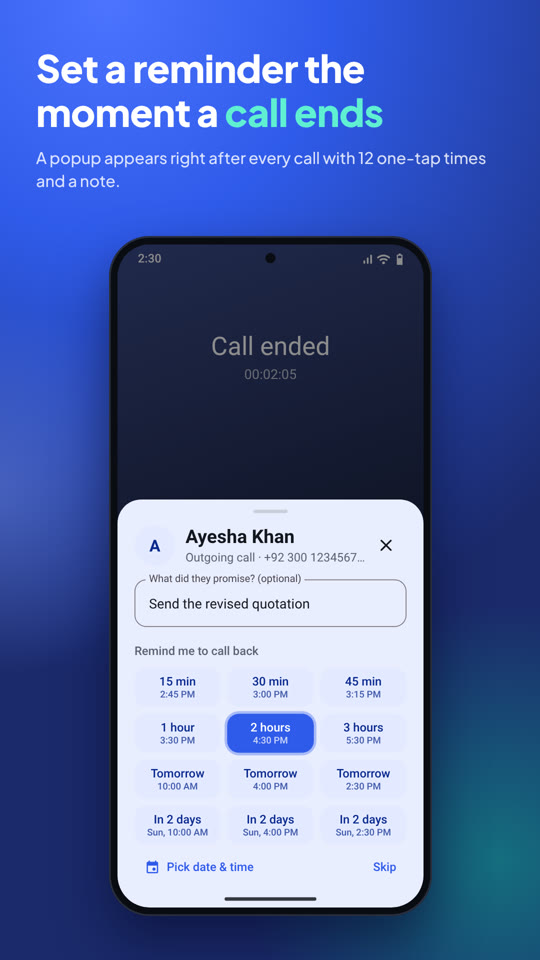
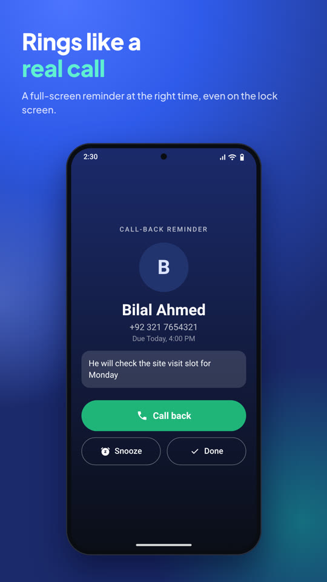
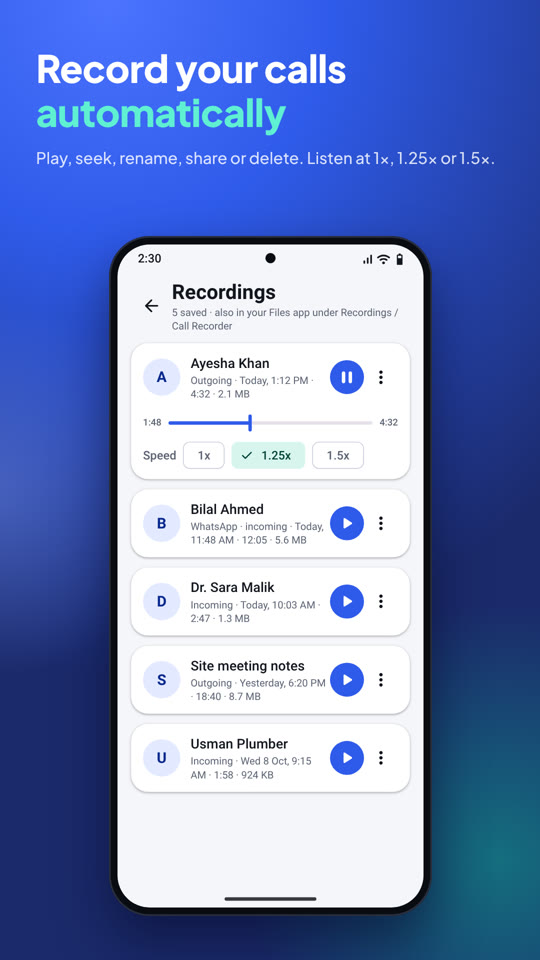

</div>

---

## Contents

- [Features](#features)
- [Screenshots](#screenshots)
- [Install](#install)
- [First-time setup](#first-time-setup)
- [How call recording works](#how-call-recording-works)
- [Privacy](#privacy)
- [Build from source](#build-from-source)
- [How it works inside](#how-it-works-inside)
- [Changelog](#changelog)

## Features

### 📞 After-call popup
- Slides up **the moment a call ends**: phone calls *and* WhatsApp voice/video calls.
- **12 one-tap reminder times** in a 3 × 4 grid, each showing the exact time it will ring:

  | | | |
  |---|---|---|
  | 15 min | 30 min | 45 min |
  | 1 hour | 2 hours | 3 hours |
  | Tomorrow 10 am | Tomorrow 4 pm | Tomorrow, same time as now |
  | In 2 days 10 am | In 2 days 4 pm | In 2 days, same time as now |

- Add a note (*"What did they promise?"*), or **pick any date and time**.
- Unknown number? Type who it was.
- **Smart with call waiting**: if several calls overlap you get one popup per person you actually talked to
  ("Call 1 of 2"). Callers who only rang while you were busy are left out.
- Choose which calls show the popup: **outgoing, incoming, missed, WhatsApp**.
- If Android blocks the popup, a notification ("Set a follow-up call?") opens it instead.

### ⏰ Reminders that ring like a call
- At the due time a **full-screen reminder** opens and the phone rings, **even on the lock screen**.
- It rings at your **ringtone volume**, vibrates in vibrate mode and stays quiet in silent mode. It keeps ringing until
  you act (with a 30-minute safety stop), and stays quiet if you are already on a call.
- **Call back** dials immediately on your SIM, with no dialer screen and no unlocking (needs the "Call directly"
  permission; otherwise the dialer opens).
- **Snooze** for 10 min, 30 min, 1 h, 3 h, tomorrow morning, or any date and time. **Done** files it away.
- Several reminders due at once are shown together on one screen.
- Pick your own **reminder ringtone**.

### 📋 Call-backs list
- Grouped into **Overdue**, **Later today** and **Upcoming**, with live "In 1 h" / "Overdue by 45 min" labels.
- Call, Snooze or Done right from each card; change the time or delete from the ⋮ menu.
- **Done** tab with your finished call-backs, and "Call again" / "Reschedule".
- **New reminder** button to add a follow-up by hand, with a contact picker.
- Reminders survive a phone restart or app update.

### 🎙️ Call recording
- Records **phone calls automatically**, and optionally **WhatsApp calls**.
- **Recordings screen** (microphone icon on the home screen): play, seek, **playback speed 1x / 1.25x / 1.5x**,
  rename, share, delete.
- Saved as `.m4a` in the phone's **Recordings / Call Recorder** folder, so they also show in the Files app.
  The contact's name and number are added from the call log after the call.
- **Recording source**: *Automatic* (default) moves to the next source by itself if a call comes out silent, or
  pick Voice recognition, Voice communication, Microphone, Call audio or Unprocessed.
- **Test the microphone**: records 5 seconds and tells you if sound was captured.
- **Auto-delete** after 30 / 60 / 90 days or 6 months, or keep forever.
- Accidental recordings shorter than 3 seconds are discarded.

### 🧪 Try it out
Settings has **Preview the after-call popup** and **Ring a test reminder in 10 seconds**, so you can test everything
without making a real call.

## Screenshots

| | | |
|:-:|:-:|:-:|
|  |  |  |
| 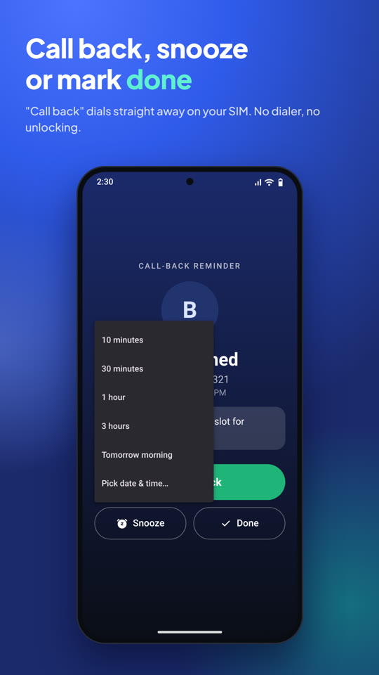 | 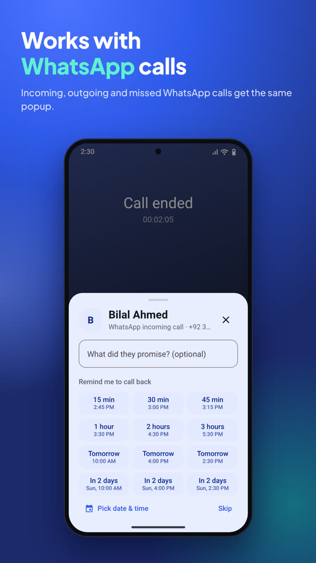 | 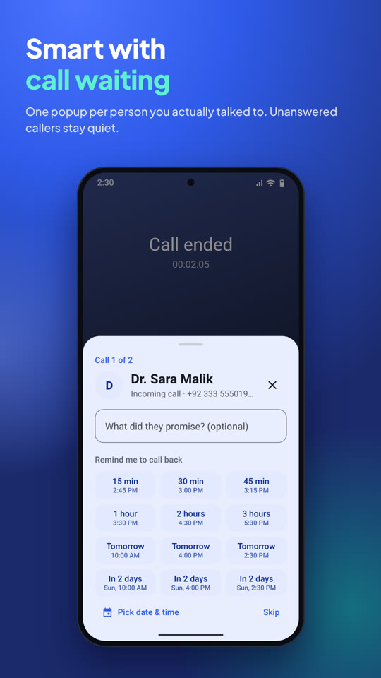 |
|  | 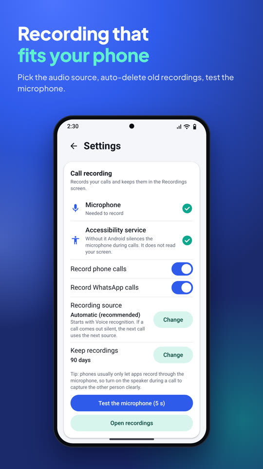 | 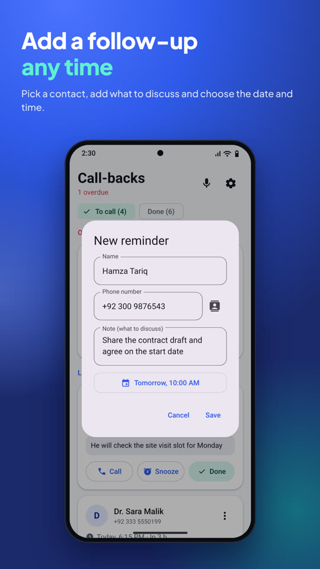 |
| 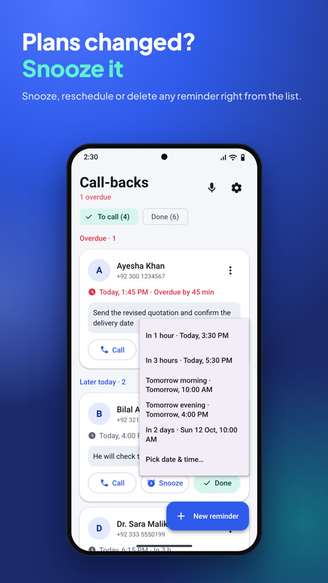 | 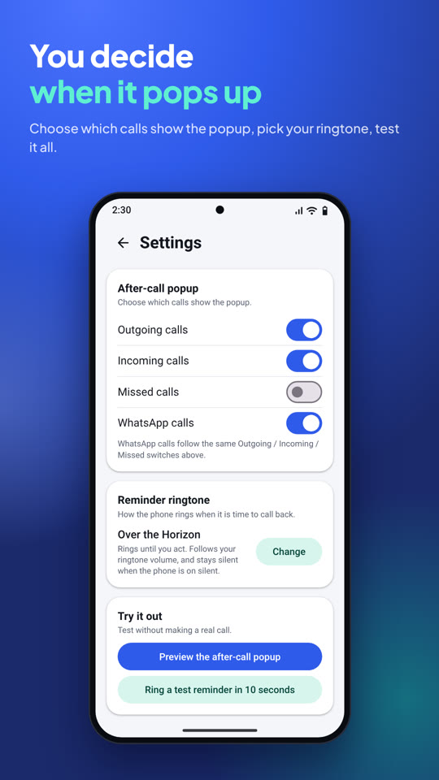 | 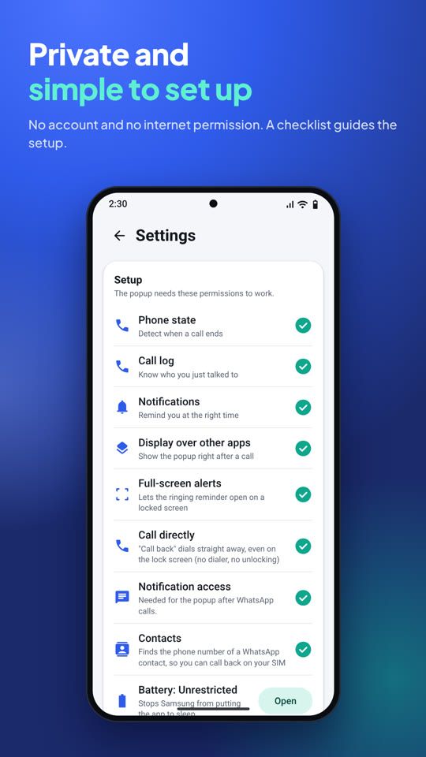 |

<sub>Screens are recreated from the app's UI code with sample names and numbers.</sub>

## Install

1. On your phone, open this repository's **[Releases](../../releases)** page and download **`CallbackReminder.apk`**
   from the release named **Latest build**.
2. Open the file and allow installing from this source when Android asks.
3. Every push to `main` rebuilds this APK. Updates install over the old version and keep your data.

Built and tested on a Samsung Galaxy S25 Ultra (One UI 8.5, Android 16). Works on Android 8.0 and newer.

## First-time setup

Open the app and tap **⚙ Settings**. The **Setup** checklist shows a green tick for everything that is done and an
**Allow** button for everything that is not:

| Permission | Why |
|---|---|
| Phone state | Detect when a call ends |
| Call log | Know who you just talked to |
| Notifications | Remind you at the right time |
| Display over other apps | Show the popup right after a call |
| Full-screen alerts (Android 14+) | Open the ringing reminder on a locked screen |
| Call directly | "Call back" dials straight away |
| Notification access | Detect WhatsApp calls |
| Contacts | Find the number of a WhatsApp contact |
| Battery: Unrestricted | Stop Samsung from putting the app to sleep |
| Microphone | Record calls |
| Accessibility service | Keep the microphone working during calls |

> **If a permission or the Accessibility switch is greyed out:** open **App info**, tap the **⋮** menu
> (top right), choose **Allow restricted settings**, then try again. Android does this for apps installed
> from outside the Play Store.

On Samsung phones, also set the app's battery to **Unrestricted** (App info → Battery) so reminders and call
detection are never delayed.

## How call recording works

Android does not let normal apps record the phone line itself, so the app records **through the microphone**.

- Switch on the app's **Accessibility service** once (*Settings → Call recording → Accessibility service*). Without
  it Android silences the microphone during calls. The service does nothing else: it ignores all events and cannot
  read the screen.
- The other person is only heard clearly if you use the **speaker** during the call.
- If a call comes out silent, the recording shows a warning and *Automatic* tries the next source on the next call.
- Results depend on the phone and Android version. **Recording laws differ between countries**, so make sure
  recording is allowed where you are, and tell the other person when the law requires it.

## Privacy

- All data (reminders, notes, the recordings list) is stored on the phone.
- The app has **no internet permission**, so it cannot upload anything.
- No account, no ads, no analytics.
- Recordings are normal audio files in the shared Recordings folder. Apps you have given "Music and audio" access
  can read them.

## Build from source

Requirements: JDK 17, Gradle 8.10.2, Android SDK 35.

```bash
gradle assembleDebug
# APK: app/build/outputs/apk/debug/app-debug.apk
```

GitHub Actions ([`.github/workflows/build.yml`](.github/workflows/build.yml)) does the same on every push to `main`
and publishes the APK as the **Latest build** release.

> The APK is signed with a shared test key (`keystore/callback-test.jks`) so each build installs as an update.
> Create your own private key before publishing to the Play Store.

## How it works inside

- **Kotlin + Jetpack Compose (Material 3)**, `minSdk 26`, `targetSdk 35`. No third-party libraries beyond AndroidX
  and coroutines.
- **Call detection**: a `PHONE_STATE` broadcast receiver groups ringing / off-hook / idle changes into a session,
  then reads the call log entries added during that session to decide who gets a popup.
- **WhatsApp calls**: a notification listener watches WhatsApp's call notifications (they never reach the call log)
  and looks the caller's number up in your contacts.
- **Reminders**: exact alarms via `AlarmManager.setAlarmClock`, a foreground service that plays the ringtone, and
  a full-screen activity shown over the lock screen. A boot receiver re-arms alarms after a restart.
- **Recording**: `MediaRecorder` writing `.m4a` files through `MediaStore`, kept alive during calls by an
  Accessibility service (or a microphone foreground service as fallback).

```
app/src/main/java/com/callbackreminder/app/
  PostCallScreen.kt / PostCallActivity.kt   after-call popup
  CallQueue.kt                              who gets a popup (call waiting logic)
  Receivers.kt                              call start/end detection, reminder alarms, boot
  WhatsAppCallListener.kt                   WhatsApp call detection
  RingService.kt / ReminderAlertActivity.kt ringing full-screen reminder
  ReminderStore.kt / Scheduler.kt           reminders and their alarms
  Notifier.kt                               notification channels and backup notifications
  CallRecorder.kt / Recording.kt            recording engine, storage, playback
  RecordingsScreen.kt                       recordings list and player
  HomeScreen.kt / SettingsScreen.kt         main screens
  AddReminderDialog.kt / Components.kt      new-reminder dialog, date & time picker, avatars
  Helpers.kt / Theme.kt                     settings, formatting, permissions status, colours
```

## Changelog

### 0.4.0
- **Call recording**, Recordings screen with playback speed (1x / 1.25x / 1.5x), recording settings and
  microphone test.
- After-call popup now has 12 reminder times (3 × 4 grid) and appears with no delay after the call ends.

### 0.3.1
- Fixed a second, blank "Unknown caller" popup after WhatsApp calls.

### 0.3.0
- **Call directly** from the reminder, without opening the dialer.
- **WhatsApp calls** get the same after-call popup (outgoing, incoming, missed).
